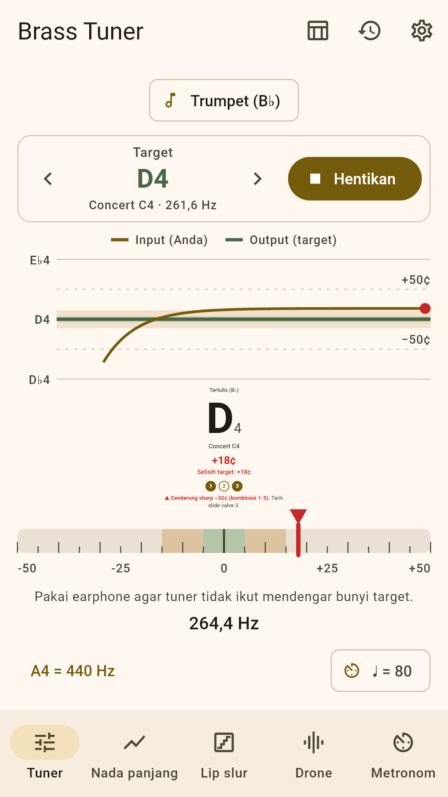
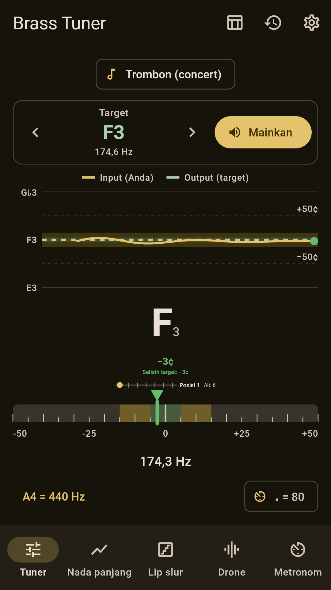
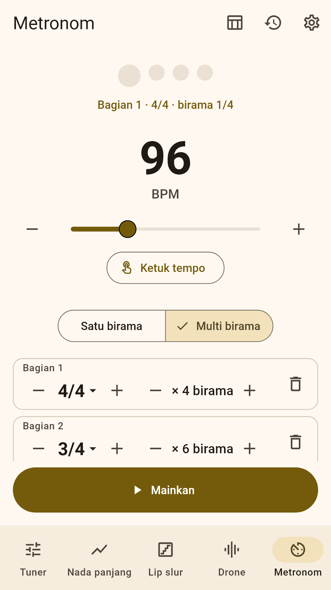
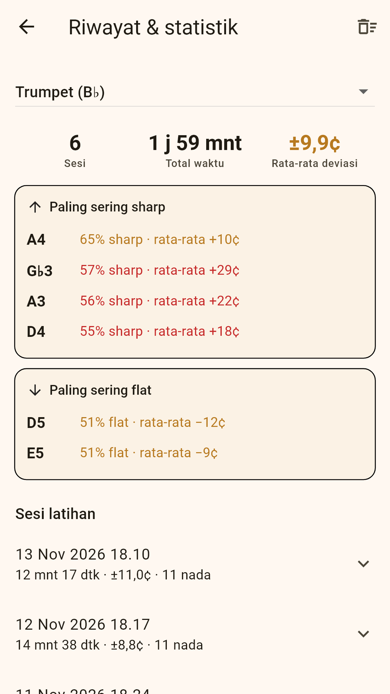

# Brass Tuner

Tuner dan alat latihan untuk pemain alat musik brass: trumpet, flugelhorn,
mellophone, horn F, alto horn, bariton, euphonium, trombon, dan tuba.
Dibuat dengan Flutter, berjalan **100% offline**, tanpa akun, iklan, atau
backend.

<p>
  
  
  
  
</p>

## Fitur

**Tuner**
- Deteksi nada McLeod Pitch Method (MPM) dengan fallback YIN, 30–1500 Hz
  (pedal tuba sampai trumpet tinggi).
- Nada tertulis dan concert otomatis sesuai alat (B♭, F, E♭, concert).
- Meter cents ±50 dengan zona hijau (±5¢), kuning (±15¢), dan merah.
- Kalibrasi A4 430–450 Hz.
- **Nada target**: pilih nada, bunyikan sebagai referensi, lalu lihat grafik
  input (suara Anda) dibanding output (target) secara langsung. Grafik
  otomatis zoom ke ±1 semiton saat Anda dekat target.
- Penjarian untuk nada yang dimainkan (3 piston, 4 piston, horn F, posisi
  slide trombon) beserta tips intonasi, misalnya 1-3 cenderung sharp → tarik
  slide 3.

**Latihan**
- **Nada panjang**: grafik cents terhadap waktu, rata-rata, dan kestabilan.
- **Lip slur**: latihan perpindahan partial, dengan cek ketepatan tiap nada.
- **Drone**: nada referensi sinus atau gergaji, oktaf 1–5.
- **Metronom**: 30–250 BPM dan tap tempo; bisa berjalan bersama tuner.
  - **Multi birama**: susun bagian seperti 4/4 × 4 birama lalu 3/4 × 6
    birama. Program diputar berurutan dan diulang tanpa berhenti.

**Lainnya**
- Tabel penjarian lengkap per alat.
- Riwayat latihan otomatis (SQLite lokal) dengan statistik nada yang paling
  sering sharp atau flat.
- Tema terang, gelap, atau mengikuti sistem.
- Layar tetap menyala selama tuner mendengar.
- Antarmuka Bahasa Indonesia dan Inggris.

## Menjalankan

Kebutuhan: Flutter 3.47+ (Dart SDK ^3.13.5). Target utama Android 7.0+
(minSdk 24); iOS ikut dikonfigurasi.

```sh
flutter pub get
flutter run
```

Mikrofon dibutuhkan untuk tab Tuner, Nada panjang, dan Lip slur. Saat drone
atau nada target berbunyi dari speaker, tuner ikut mendengarnya, jadi pakai
earphone untuk melihat intonasi Anda sendiri.

## Pengembangan

```sh
flutter analyze          # lint
flutter test             # unit + widget test (DSP diuji dengan sinyal sintetis)
flutter gen-l10n         # setelah mengubah lib/l10n/*.arb
```

Alat bantu di `tool/`:

| Perintah | Fungsi |
| --- | --- |
| `dart compile exe tool/benchmark_dsp.dart -o build/bench.exe && build/bench.exe` | Benchmark DSP per update |
| `flutter test tool/screenshots_test.dart` | Membuat screenshot toko dan feature graphic di `store/` |
| `flutter test tool/generate_brand_test.dart` | Membuat ikon dan splash di `assets/brand/` |

## Arsitektur

Clean architecture dengan Riverpod untuk state.

```
lib/
  core/
    audio/      mic (record), konversi PCM, sliding window, output suara
    pitch/      MPM, YIN, FFT, noise gate, smoothing, note mapper,
                PitchWorker (isolate DSP)
    synth/      oscillator, drone, metronom presisi-sampel, mixer
  features/
    tuner/      layar tuner, nada target, grafik input vs output
    fingering/  penjarian, tips intonasi, tabel penjarian
    long_tone/  rekaman nada panjang
    lip_slur/   latihan lip slur
    drone/      nada referensi
    metronome/  metronom, program multi birama
    history/    sesi latihan (SQLite), statistik
    settings/   alat, A4, tema
    home/       navigasi bawah, siklus hidup mic
  shared/       komponen UI dan platform bersama
  l10n/         string ID (template) dan EN
```

Alur audio: mic 44.1 kHz → window 4096 sampel, hop 1024 (≈23 ms per update) →
`PitchTracker` di isolate terpisah → `TunerController` → UI. Di laptop
pengembang, satu update DSP butuh sekitar 0,37 ms.

Metronom dan drone dirender langsung ke stream PCM, sehingga tempo tidak
bergeser karena timer.

### Dependency

| Paket | Alasan |
| --- | --- |
| `flutter_riverpod` | State management |
| `record` | Stream PCM dari mikrofon |
| `flutter_pcm_sound` | Output PCM latensi rendah untuk drone dan metronom |
| `shared_preferences` | Menyimpan pengaturan |
| `sqflite`, `path` | Database riwayat latihan |
| `wakelock_plus` | Layar tetap menyala selama tuner aktif |
| `intl`, `flutter_localizations` | i18n |
| `sqflite_common_ffi` (dev) | Menguji repository SQLite di host |
| `flutter_launcher_icons`, `flutter_native_splash` (dev) | Membuat ikon dan splash |

## Privasi

Audio diproses di memori dan langsung dibuang; tidak direkam, disimpan, atau
dikirim. APK release tidak meminta izin `INTERNET`. Lihat
[store/privacy_policy.md](store/privacy_policy.md).

## Dokumentasi

- [docs/release.md](docs/release.md): signing, build AAB, dan Play Console.
- [docs/device_testing.md](docs/device_testing.md): uji latensi, CPU, dan
  baterai di HP.
- [store/](store/): teks listing, kebijakan privasi, formulir keamanan data,
  dan aset toko.
